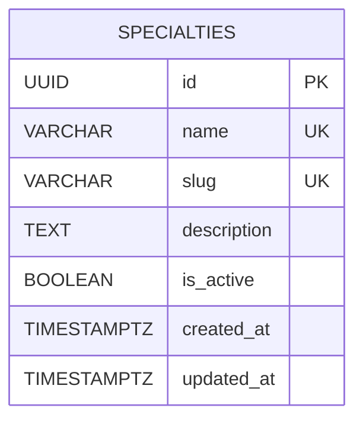

# Database Schema

## Overview

Consultant Gate uses PostgreSQL as its relational database management system.

The initial database schema introduces the `specialties` table, which stores the medical specialties available in the application.

Schema changes are managed through TypeORM migrations. Automatic schema synchronization is disabled.

## Entity: Specialties

The `specialties` table stores medical specialty information.

| Column | Data Type | Nullable | Default | Constraints |
|---|---|---|---|---|
| `id` | UUID | No | `gen_random_uuid()` | Primary Key |
| `name` | VARCHAR(150) | No | None | Unique |
| `slug` | VARCHAR(150) | No | None | Unique |
| `description` | TEXT | Yes | NULL | None |
| `is_active` | BOOLEAN | No | TRUE | None |
| `created_at` | TIMESTAMPTZ | No | CURRENT_TIMESTAMP | None |
| `updated_at` | TIMESTAMPTZ | No | CURRENT_TIMESTAMP | None |

## Schema Diagram



## Constraints

### Primary Key

- `id` uniquely identifies each specialty.
- UUID values are generated by PostgreSQL using `gen_random_uuid()`.

### Unique Constraints

- `uq_specialties_name`: prevents duplicate specialty names.
- `uq_specialties_slug`: prevents duplicate specialty slugs.

### Required Fields

- `name` and `slug` are mandatory.
- `is_active`, `created_at`, and `updated_at` have database defaults.

### Optional Fields

- `description` can be NULL.

## Timestamps

- `created_at` records when the record is created.
- `updated_at` is initialized using `CURRENT_TIMESTAMP`.

Note: The current schema defines a default value for `updated_at` on insertion. Automatic updates to this column when a record changes are not currently implemented.

## Relationships

The initial schema contains one table and does not define foreign key relationships.

Additional relationships should be introduced through separate migrations when required by future application features.

## Migration Management

The schema is created by:

`CreateSpecialtiesTable1794428234406`

To apply migrations:

```bash
pnpm --filter api migration:run
```

To inspect migration status:

```bash
pnpm --filter api migration:show
```

To revert the latest migration:

```bash
pnpm --filter api migration:revert
```

All schema modifications must be implemented through version-controlled migrations.